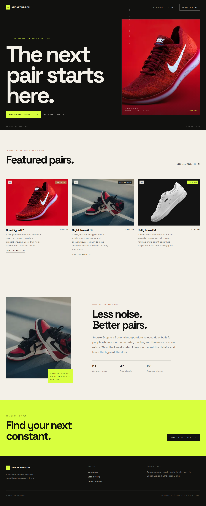
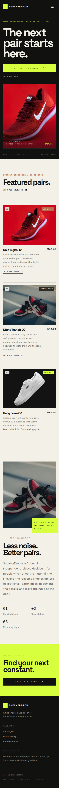
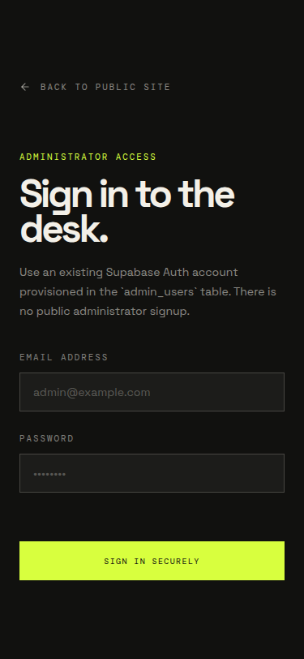

# SneakerDrop

SneakerDrop is a fictional premium sneaker release desk built for a Web Development Internship Challenge. It is not a checkout or ecommerce platform. The product is a focused public catalogue with product detail routes, product-specific waitlists, and a protected administrator workspace for managing the release edit.

The experience uses a concrete editorial streetwear direction: near-black release bands, warm paper catalogue surfaces, thin rules, oversized typography, mono metadata, and a signal-lime action color. Product records are loaded from Supabase at request time, so the catalogue is backed by real database data rather than a local mock array.

## Features

The public experience includes a responsive header and mobile navigation, editorial hero, featured products, live catalogue, product detail pages, brand story, footer, image treatments, availability labels, loading and not-found states, and reduced-motion-aware reveals. Each eligible product exposes a waitlist form that identifies the product, validates the email in the browser and on the server, persists through a Supabase RPC, and reports duplicate subscriptions clearly.

The protected `/admin` workspace uses Supabase Auth plus a database-backed `admin_users` role table. Authorized administrators can view, create, edit, and delete products, change availability, update prices and image URLs, and view/search waitlist submissions. Product deletion uses `ON DELETE RESTRICT` so subscriber history is not silently erased.

## Screenshots

These screenshots were captured from the implemented development site rather than concept art.







## Technology stack

- Next.js 14 App Router with React 18
- Strict TypeScript
- Tailwind CSS and CSS tokens
- Framer Motion for restrained reveal and interaction motion
- Supabase PostgreSQL, Supabase Auth, PostgREST, RPC, and Row Level Security
- pnpm 10 with a checked-in lifecycle-script policy
- Git and Vercel are the intended source-control and production targets

## Local setup

```bash
pnpm install
cp .env.example .env.local
# Fill .env.local with the Supabase URL and publishable/anon key.
pnpm dev
```

The local server runs on `http://localhost:3000`. The production checks are:

```bash
pnpm typecheck
pnpm lint
pnpm build
```

Do not commit `.env`, `.env.local`, service-role keys, build output, or `node_modules`. The application only needs the publishable/anon key for its public and server-side RLS flows. It does not place a service-role key in the browser bundle.

## Environment variables

Use `.env.example` as the template. The preferred names for Vercel are:

```text
NEXT_PUBLIC_SUPABASE_URL=https://your-project.supabase.co
NEXT_PUBLIC_SUPABASE_PUBLISHABLE_KEY=your-publishable-or-anon-key
```

The managed development environment also provides `SUPABASE_URL` and `SUPABASE_KEY`; the server helper accepts those names as a fallback. Never place a service-role key in a `NEXT_PUBLIC_*` variable.

## Supabase setup

The version-controlled SQL lives in `supabase/migrations/` and `supabase/seed.sql`. Apply the migrations in filename order through the Supabase SQL Editor or the Supabase CLI, then run the seed file. The current connected Supabase project used during implementation is the accessible `SneakerDrop` project with ref `xdgdrivkqvnnxyfvmwaa` in `ap-southeast-1`. The original challenge text named `boaosifynvzqjadhnypm`; that endpoint was not the project exposed by the authorized environment. If that was the intended target, point the environment variables at it and apply the same migration and seed files there before deployment.

The seed inserts three fictional records without overwriting an existing record with the same slug:

- `Sole Signal 01` — low stock — `$180.00`
- `Night Transit 02` — coming soon — `$210.00`
- `Rally Form 03` — in stock — `$165.00`

The image URLs are stable HTTPS Unsplash image URLs. The application configures the hostname in `next.config.mjs` and checks the records at runtime through Supabase.

## Database schema and relationships

`products` stores the public catalogue: UUID primary key, name, unique slug, description, numeric price, image URL, constrained availability enum, and created/updated timestamps. A timestamp trigger updates `updated_at` on edits. Indexes cover availability and newest records.

`waitlist` stores UUID id, `product_id`, normalized lowercase email, and created timestamp. It has a foreign key to `products` with `ON DELETE RESTRICT` and a database-level unique constraint on `(product_id, email)`. A visitor may join multiple products, but cannot join the same product twice.

`admin_users` maps an existing Supabase Auth user UUID to administrator authorization. It has a foreign key to `auth.users` with `ON DELETE CASCADE`. The `is_admin()` security-definer function is used only for policy checks and fixes `search_path` to `public`.

## Administrator provisioning

There is intentionally no public administrator signup. To provision the first administrator:

1. Create the user in Supabase Dashboard → Authentication → Users, using the dashboard’s controlled invitation or password flow.
2. Copy the resulting Auth user UUID.
3. In the Supabase SQL Editor, run:

```sql
insert into public.admin_users (user_id)
values ('AUTH_USER_UUID_HERE')
on conflict (user_id) do nothing;
```

4. Open `/admin/login` and sign in with that existing Auth account.

The browser-facing UI is not the authorization boundary. Route handlers and database policies both verify the authenticated user and administrator role.

## Authentication and RLS security

Products are publicly readable through a narrow select policy. Product insert, update, and delete operations require an authenticated user for whom `is_admin()` is true. `admin_users` is readable only by an authenticated user for their own role row; it has no public write policy. `waitlist` has no public table select or insert privilege. Public submissions call the `submit_waitlist(product_id, email)` security-definer function, which checks that the product exists, normalizes the email, validates it again at the database boundary, and inserts it subject to the unique constraint. Waitlist reads are restricted to authorized administrators.

Middleware refreshes Supabase sessions. Application cookies are written with `SameSite=None; Secure` for the HTTPS embedded Preview context. Error responses are generic and do not include private subscriber data or privileged credentials.

## Application architecture

`app/` contains the public pages, protected admin page, middleware, and route handlers. `components/` contains the header, hero, cards, catalogue grid, waitlist form, login form, and admin dashboard. `lib/` contains shared types, Zod schemas, Supabase clients, auth guards, and data access helpers. `supabase/migrations/` and `supabase/seed.sql` are the database source of truth. `public/manus-routes.json` declares the page route set for the managed preview.

Public pages are server-rendered and use live Supabase reads. The waitlist form and administrator dashboard are client components because they need interactive loading states, form feedback, filters, and mutation controls. Product mutations go through protected server route handlers and are invalidated naturally on the next dynamic server render.

## Product CRUD workflow

The dashboard loads products and waitlist rows after `requireAdmin()` completes. The add/edit dialog validates name, slug, description, non-negative numeric price, HTTPS image URL, and availability in the browser and again in the route handler. Database constraints handle the final boundary and duplicate slug errors become useful inline messages. Delete requires a browser confirmation step and returns a deliberate dependency message when waitlist rows prevent deletion.

## Waitlist workflow

The product detail page shows a product-specific form for low-stock and coming-soon releases. The client checks the product UUID and email before POSTing to `/api/waitlist`. The route validates again, calls the database RPC, and translates uniqueness, missing-product, malformed-email, and unexpected errors into safe user-facing messages. No email delivery is claimed because no delivery service is configured.

## Verification performed

The following checks were run against the local app and the connected Supabase project:

- `pnpm install` completed successfully with the pinned lockfile.
- `pnpm typecheck` passed.
- `pnpm lint` passed with no warnings or errors.
- `pnpm build` passed and generated all public, admin, and API routes.
- `GET /`, `/catalogue`, `/products/sole-signal-01`, `/admin/login`, and `/manus-routes.json` returned HTTP 200 from the running Next.js server.
- The homepage HTML contained all three Supabase-seeded product names.
- Three product records were confirmed through the Supabase REST API with a bounded select.
- The referenced sneaker image URLs returned HTTP 200 `image/jpeg` responses.
- Malformed waitlist email returned HTTP 400.
- A valid waitlist submission returned HTTP 201.
- The same email for the same product returned HTTP 409 after normalization.
- The same normalized email for a different product returned HTTP 201.
- Anonymous direct REST access to `waitlist` returned HTTP 401/permission denied.
- The unauthenticated `/admin` request produced a Next redirect payload to `/admin/login`; production `POST`, `PATCH`, and `DELETE` admin mutation requests returned HTTP 401. An actual administrator login was not executed because no admin Auth credentials were provided.
- The Supabase project reports RLS enabled for `products`, `admin_users`, and `waitlist`, with three product rows and two QA waitlist rows from the behavior test.
- Production browser inspection found no console output/errors and Vercel reported no grouped runtime errors in the verification window. Screenshots were captured at 1366px and 375px widths. The route set was visually checked for responsive navigation, card stacking, readable forms, and no horizontal overflow.

The two QA rows use the synthetic address `qa20261028@example.com` for the two waitlist behavior checks. They are not customer data. Remove them from the Supabase dashboard if a clean database is required before evaluation.

## Deployment status

The application is pushed to the requested public GitHub repository: https://github.com/hanuma-svg/SneakerDrop. The verified production commit is `484b4d577171a996c520109456a1a5c173dd745f` (`Merge existing GitHub repository history`). The Vercel project is connected to `hanuma-svg/SneakerDrop` on `main` and the verified production URL is https://sneakerdrop-pi.vercel.app/.

Vercel Production, Preview, and Development contain `NEXT_PUBLIC_SUPABASE_URL` and the encrypted `NEXT_PUBLIC_SUPABASE_PUBLISHABLE_KEY`. The URL is `https://xdgdrivkqvnnxyfvmwaa.supabase.co`, matching the Supabase project ref where the migrations and seed data were applied. The production redeploy completed with `READY` status from commit `484b4d5…`. Public production catalogue, product detail, availability, waitlist validation/persistence/duplicate handling, protected-route behavior, browser console, and Vercel runtime-error checks were executed successfully. Authenticated admin login, CRUD, and admin waitlist viewing remain unverified because no provisioned administrator credentials were supplied; provision one using the instructions above, then repeat those checks against the live URL.

The final production audit found and fixed a dependency vulnerability set before this remediation was deployed: Next.js was upgraded to `15.5.28`, `@supabase/ssr` to `0.12.7`, `@supabase/supabase-js` to `2.118.0`, Zod to `4.6.6`, PostCSS to `8.5.23`, and the Next ESLint preset to `15.5.28`. Next 15 compatibility fixes use async cookies, async route params, and async search params without changing the application architecture. `pnpm audit --prod` now reports zero low, moderate, high, or critical vulnerabilities. The latest audit commit and resulting Vercel deployment must be confirmed after the push below; the prior READY deployment remains the last verified live application version until then.

## Known limitations and future improvements

The challenge intentionally does not add checkout, cart, payments, order tracking, customer accounts, or confirmation emails. The waitlist currently persists reliably but has no email delivery service. Product image URLs are external Unsplash assets rather than Supabase Storage assets. A production hardening pass could add rate limiting or CAPTCHA to the public waitlist RPC route, an admin-side waitlist export/archive workflow, Supabase Storage image uploads, automated browser tests, and a transactional email provider.
